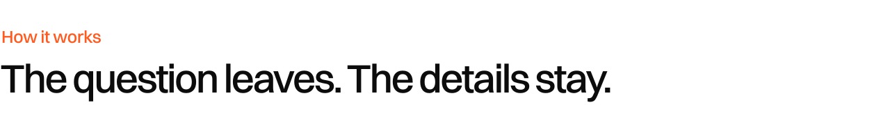
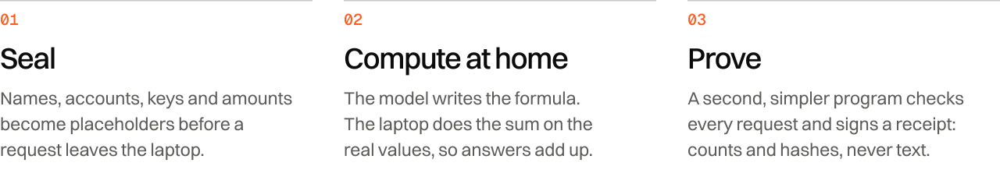
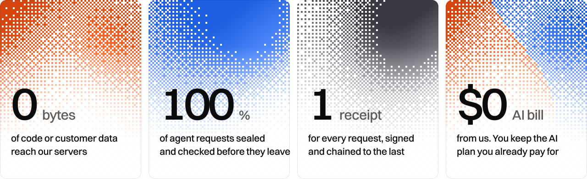
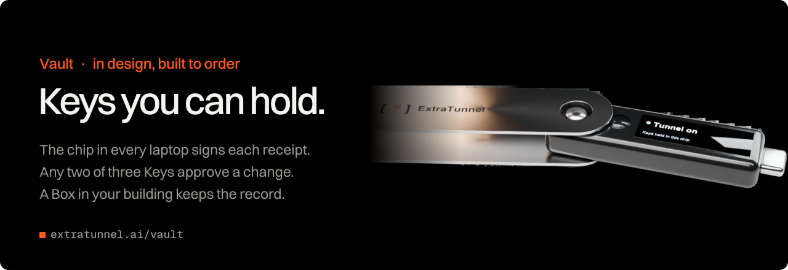

<!--
  ExtraTunnel. Every image on this page is drawn by code in the language of extratunnel.ai:
  real values in orange, placeholders in blue, the seal in green, the logo's brackets.
-->

<picture><source media="(prefers-color-scheme: dark)" srcset="https://raw.githubusercontent.com/extratunnel/.github/main/profile/assets/dark/hero.svg"></picture>

**Use Claude Code, Codex, Cursor and Copilot on code full of customer data.** ExtraTunnel seals it on the laptop before any request leaves, puts the real values back in the answer, and signs a receipt for every request.

<a href="https://extratunnel.ai/get-started"><picture><source media="(prefers-color-scheme: dark)" srcset="https://raw.githubusercontent.com/extratunnel/.github/main/profile/assets/dark/btn-start.svg"></picture></a><a href="https://extratunnel.ai/get-started#backtest"><picture><source media="(prefers-color-scheme: dark)" srcset="https://raw.githubusercontent.com/extratunnel/.github/main/profile/assets/dark/btn-backtest.svg"></picture></a><a href="https://extratunnel.ai"><picture><source media="(prefers-color-scheme: dark)" srcset="https://raw.githubusercontent.com/extratunnel/.github/main/profile/assets/dark/btn-site.svg"></picture></a>

 

<picture><source media="(prefers-color-scheme: dark)" srcset="https://raw.githubusercontent.com/extratunnel/.github/main/profile/assets/dark/h-how.svg"></picture>

<picture><source media="(prefers-color-scheme: dark)" srcset="https://raw.githubusercontent.com/extratunnel/.github/main/profile/assets/dark/seal.svg"></picture>

<picture><source media="(prefers-color-scheme: dark)" srcset="https://raw.githubusercontent.com/extratunnel/.github/main/profile/assets/dark/steps.svg"></picture>

 

<picture><source media="(prefers-color-scheme: dark)" srcset="https://raw.githubusercontent.com/extratunnel/.github/main/profile/assets/dark/h-agents.svg"></picture>

<picture><source media="(prefers-color-scheme: dark)" srcset="https://raw.githubusercontent.com/extratunnel/.github/main/profile/assets/dark/agents.svg"></picture>

It sits under every agent on the laptop: the terminal, the editor, your scripts and the browser. Your Zscaler, Netskope or Purview stays the only thing in the network path.

 

<picture><source media="(prefers-color-scheme: dark)" srcset="https://raw.githubusercontent.com/extratunnel/.github/main/profile/assets/dark/h-true.svg"></picture>

<picture><source media="(prefers-color-scheme: dark)" srcset="https://raw.githubusercontent.com/extratunnel/.github/main/profile/assets/dark/numbers.svg"></picture>

 

<a href="https://extratunnel.ai/vault"><picture><source media="(prefers-color-scheme: dark)" srcset="https://raw.githubusercontent.com/extratunnel/.github/main/profile/assets/dark/vault.svg"></picture></a>

 

<picture><source media="(prefers-color-scheme: dark)" srcset="https://raw.githubusercontent.com/extratunnel/.github/main/profile/assets/dark/h-start.svg"></picture>

**Engineers** start free, with every agent, set up with our team on a call. **Security teams** start with a paid back-test on 500 of their own files, offline, against a pass mark they set first.

<a href="https://extratunnel.ai/get-started"><picture><source media="(prefers-color-scheme: dark)" srcset="https://raw.githubusercontent.com/extratunnel/.github/main/profile/assets/dark/btn-start.svg"></picture></a><a href="https://extratunnel.ai/get-started#backtest"><picture><source media="(prefers-color-scheme: dark)" srcset="https://raw.githubusercontent.com/extratunnel/.github/main/profile/assets/dark/btn-backtest.svg"></picture></a><a href="https://extratunnel.ai"><picture><source media="(prefers-color-scheme: dark)" srcset="https://raw.githubusercontent.com/extratunnel/.github/main/profile/assets/dark/btn-site.svg"></picture></a>

 

<picture><source media="(prefers-color-scheme: dark)" srcset="https://raw.githubusercontent.com/extratunnel/.github/main/profile/assets/dark/footer.svg"></picture>
